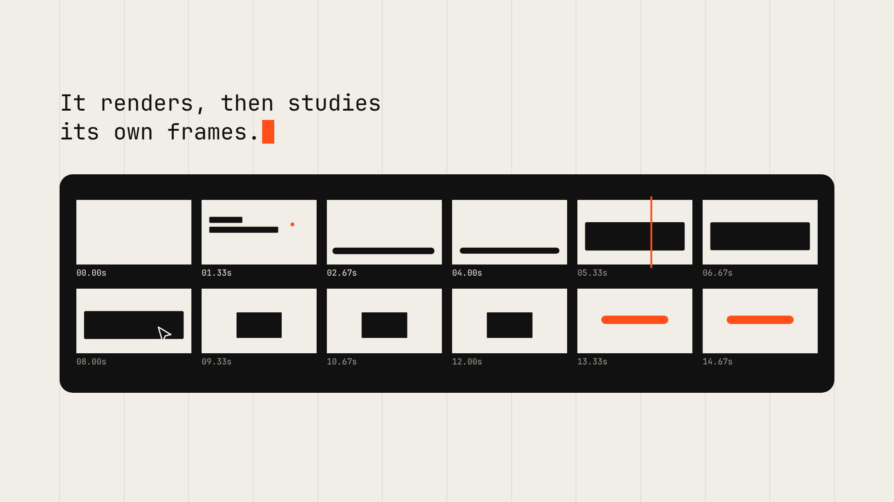
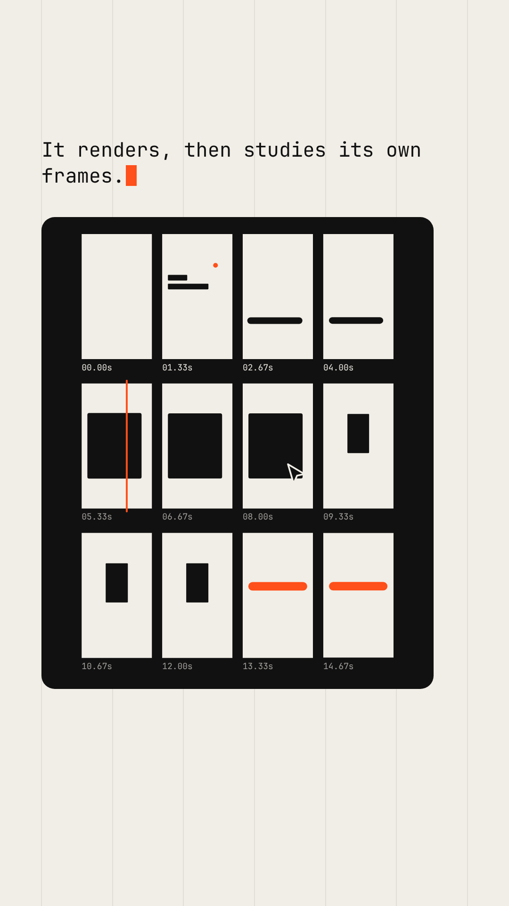
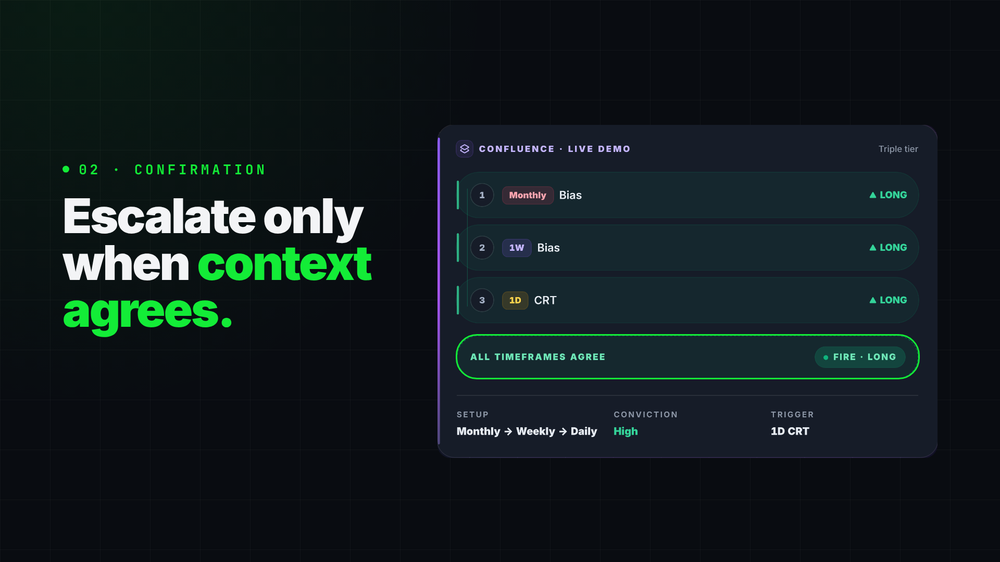
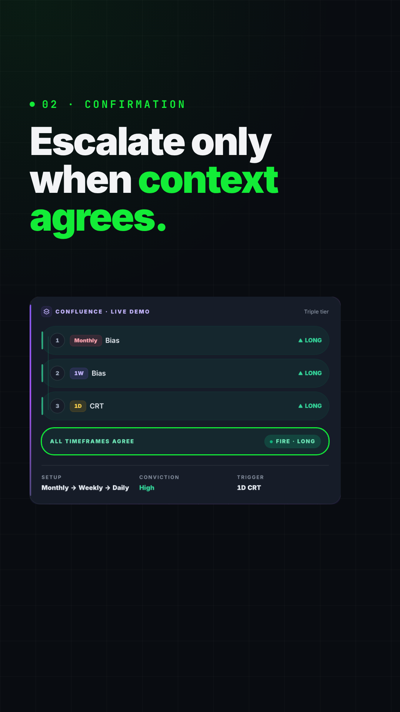

# Motion with Opus 5.5

Студия моушн-дизайна из кода для Claude Code. Скилл **`/motion-reel`** превращает
бриф или URL продукта в готовый ролик. Opus пишет программу `seek(t)`, headless
Chromium рисует по ней кадры, ffmpeg склеивает их в MP4, звук синтезируется на тех
же таймкодах. Перед тем как показать результат, агент сам смотрит контактные листы
и исправляет худшие дефекты.

<p>
  
  
</p>

Демо-ролик `films/demo` («seek(t)», 16 с, 16:9 и 9:16) целиком собран этим
пайплайном: [16:9](docs/demo-16x9.mp4) · [9:16](docs/demo-9x16.mp4) ·
[финальное ревью: контактные листы, полосы кадров, тест телефона, оценки критика](docs/demo-review/).

---

## Что в статье действительно полезно

Статья разбирает «one-prompt» ролики, которыми завалили ленту после выхода Opus 5.5.
Главный вывод: подпись «одним промптом» почти всегда врёт. Лучшие работы начинались
с брифа на 9–19 тыс. символов, папки скиллов и многочасового прогона агента с циклом
самокритики. Промпт даёт процентов десять результата, остальное даёт обвязка. Вот
что из статьи стоит забрать (и что здесь реализовано):

1. **Кадр — это функция времени.** Видео — это программа: `seek(t)` рисует ровно
   то, что на экране в секунду *t*. Ничего не крутится на таймере, поэтому кадр 240
   рисуется без кадров 0–239. Отсюда детерминизм, параллельный рендер и правка
   «одной секунды» вместо перегенерации всего ролика.
2. **Обвязка важнее модели.** Анимацию напишет и чат. Отрендерить её, посмотреть
   свои кадры и проверить звук может только агент с shell, то есть Claude Code.
   Именно эта обратная связь отделяет вирусные ролики от «ну, так себе».
3. **`CLAUDE.md` с правилами дома.** Запрет штампов: центрированный заголовок на
   градиенте, fade-in на всём, подписи в углах, glow на UI. Один шрифт для
   заголовков, один для интерфейса, один акцентный цвет. Что-то новое на экране
   каждые 2–4 секунды.
4. **Бриф вместо вайба.** Блоки FILM / ASSETS / VISUAL / HARD LINE / DELIVER.
   Пустые поля модель заполняет самыми безопасными дефолтами, поэтому все ролики
   и похожи друг на друга.
5. **Референс задаёт визуальную грамматику.** Кадр или клип → `style_guide.md`
   (палитра в hex, шрифты, длины планов, переходы) → `shotlist.md`. Берём
   грамматику, но не объекты, не логотипы и не тексты.
6. **Список состояний вместо списка эффектов.** У каждого бита есть входное
   состояние, выходное и причина существовать. Одна форма морфится через весь
   ролик, курсор делает реальные клики, последний кадр совпадает с первым (луп).
7. **Пружины и звук на одних часах.** Пружины в замкнутой форме
   (суперпозиция: `v0 + Σ Δv·spring(t − tᵢ)`), у каждого класса объектов свой
   характер. Звук синтезируется в коде под те же таймкоды. Чужой трек сначала
   измеряют (BPM, доли, акценты) и только потом анимируют.
8. **Критик.** Контактный лист, 12 кадров вокруг самого быстрого движения, тест
   телефона на 360 px, шов лупа, проверка детерминизма. Оценки 1–10, три худших
   дефекта, исправить и повторять, пока всё не станет ≥ 8. Этот шаг все
   пропускают, и он был у каждого ролика, который «выстрелил».
9. **Скилл и гейты.** Решения живут в файлах, а не в чате, поэтому следующий ролик
   запускается одной командой. Гейты позволяют агенту работать часами и
   останавливаться только на блокерах, например когда нет реального скриншота
   продукта.

Что в статье шум: просмотры и «$1200 за ролик» — это анекдоты, а не данные.
И честное ограничение: код проигрывает на фотореализме, сложных персонажах и
органичном движении. Там нужен футаж или видеомодель как базовый слой.

## Что даёт этот репозиторий

| Идея из статьи | Что здесь сделано |
|---|---|
| `seek(t)` + Playwright + ffmpeg | `render.mjs`: параллельные процессы Chromium, упорядоченная запись в один ffmpeg, все форматы из одного таймлайна, рендер отдельных секунд (`--from/--to`), стиллы, аниматик 960×540, постер, точный цвет (bt709, ±2 уровня) |
| Контракт рендера | рантайм подменяет `Math.random` на сидированный генератор, отключает CSS-анимации, ждёт шрифты и картинки, считает таймеры и часы внутри `seek()` и не рендерит, если не хватает ассета |
| Бриф, style guide, shot list | шаблоны и `new-film.mjs` (рабочий скелет фильма), `capture.mjs` (реальные скриншоты, картинки, лого, цвета и шрифты с сайта продукта), `reference.mjs` (листы кадров, склейки, длины планов и палитра из референс-клипа) |
| Список состояний | `morph()`: одна форма через все состояния (размеры, радиус, цвет в OKLab), `cursorPath()`, `typeTimes()` |
| Пружины | `spring()`, `track()` (стек пружин), пресеты `feel.ui / panel / camera / headline / cursor / mascot` с измеренным временем успокоения |
| Звук | `synth.mjs`: детерминированный синтезатор (ударные, клики, набор текста, whoosh/riser/impact, пэды, бас, реверб), микс и нормализация в −14 LUFS; `beats.py`: BPM, доли, сильные доли, акценты и кривая энергии своего трека |
| Критик | `review.mjs`: contact / strip / phone / seam / signals + громкость, синхрон звука с каждым событием, «мёртвые» паузы, детерминизм (один кадр тремя способами), линт контракта, шаблон `critique.md` |
| Скилл и гейты | `/motion-reel` с 6 гейтами, `STATUS.md` для продолжения в новой сессии, заранее разрешённые команды студии для долгих прогонов |

## Быстрый старт

Нужны Node 20.6+, ffmpeg, Python 3 с numpy (для `beats.py`) и Claude Code.

```bash
git clone https://github.com/hrantm400/Motionwithopus5.5 && cd Motionwithopus5.5
npm install && npx playwright install chromium   # Chromium для рендера
pip install -r requirements.txt                  # numpy (librosa по желанию)
npm run demo     # демо в 16:9 и 9:16 + ревью → films/demo/out, films/demo/reviews
npm run preview  # открыть фильм в браузере: скраббер, звук, зоны платформ (G)
```

Дальше в Claude Code:

```
claude --model claude-opus-5-5
/effort xhigh
/motion-reel для https://your-product.com, 20s, vertical + wide, референс films/x/refs/frame.png
```

Ещё примеры:

- `/motion-reel шоурил на 15 секунд про то, какой ты моушн-дизайнер` — проверка обвязки
- `/motion-reel для https://acme.com, 30s, all, music films/acme/assets/audio/song.wav`
- `/motion-reel films/acme — на 6-й секунде текст налезает на карточку, исправь`
- `/motion-reel overnight: бриф в films/acme/brief.md, останавливайся только на блокерах`

## Что происходит после команды

| Гейт | Что делает агент | Где остаётся след |
|---|---|---|
| 1 | заполняет бриф, снимает реальные ассеты с сайта, перечисляет, чего не хватает, и **останавливается на согласование** | `brief.md`, `assets/site/` |
| 2 | разбирает референс, пишет style guide и shot list (вход → выход → зачем), **ждёт OK** | `style_guide.md`, `shotlist.md` |
| 3 | пишет `timeline.mjs` и `index.html`, делает стиллы на каждый план во всех форматах и правит раскладку | `reviews/stills-*/sheet.png` |
| 4 | аниматик 960×540 с черновым звуком: темп, паузы, синхрон | `out/*-animatic.mp4`, `reviews/rNN-*/` |
| 5 | полный рендер и цикл критика, пока все 6 оценок не станут ≥ 8 | `reviews/rNN-*/critique.md` |
| 6 | все форматы, проверка лупа, постер, README фильма | `out/`, `STATUS.md` |

Со словом «overnight» агент не ждёт согласований и останавливается только на
блокерах. Все решения записываются в `STATUS.md`.

## Команды

| Что | Команда |
|---|---|
| новый фильм | `npm run new -- acme-launch --duration 20 --formats 16x9,9x16` |
| ассеты с сайта | `npm run capture -- https://acme.com acme-launch` |
| разбор референса | `npm run reference -- films/acme-launch/refs/clip.mp4` |
| биты трека | `npm run beats -- films/acme-launch/assets/audio/song.wav --out films/acme-launch/src/beats.json` |
| стиллы на каждый план | `npm run render -- acme-launch --stills shots --format all --guides` |
| аниматик | `npm run render -- acme-launch --scale 0.5` |
| перепроверить секунды | `npm run render -- acme-launch --from 4 --to 7` |
| полный рендер | `npm run render -- acme-launch --format all` |
| ревью-пак | `npm run review -- acme-launch --format 9x16` |
| превью в браузере | `npm run preview` |

## Устройство

```
.claude/skills/motion-reel/
  SKILL.md            воркфлоу /motion-reel: гейты, цикл критика, вкус, когда спрашивать
  references/         бриф, раскадровка, API композиции, звук, критик (читаются по мере надобности)
  runtime/            runtime.mjs (контракт + плеер), motion.mjs (пружины, morph, шум), synth.mjs (звук)
  scripts/            render, review, new-film, capture, reference, beats.py, serve
  template/           шаблон фильма
films/<slug>/
  brief.md · style_guide.md · shotlist.md · STATUS.md
  assets/ refs/ src/ (index.html · timeline.mjs · score.mjs)
  out/ reviews/       (не коммитятся)
CLAUDE.md             правила дома: контракт, вкус, звук, «сначала проверь сам»
.claude/settings.json заранее разрешённые команды студии (render, review, …) для долгих прогонов
```

Скилл можно перенести в любой проект или в `~/.claude/skills/`: он
самодостаточен, фильмы создаются в `films/` текущей папки.

## Как сделано демо и что поймал критик

`films/demo` собран по тому же циклу: 3 раунда стиллов и 15 раундов ревью.
Дефекты, которые нашёл ревью-пак, и исправления:

- **утечка состояния между кадрами.** Позиция плитки кешировалась в `seek()`,
  проверка детерминизма показала расхождение. Теперь геометрия считается чистой функцией;
- **«скрытые» элементы проступали в чужих планах.** `visibility: hidden` не прячет
  детей с явным `visible`, теперь группы скрываются через `display: none`;
- **морф проезжал через уходящий заголовок** (видно на `strip.png`). Движение
  разбито на два: точка падает рядом с текстом, потом растягивается под ним;
- **грязно-коричневый переход** из чёрного в оранжевый. Теперь геометрия идёт на
  пружинах, а цвет режется на долю;
- **одиночные чёрные кадры** на стыках планов и **пустая чёрная панель**. Слои
  перекрываются хотя бы на кадр, панель уходит через перекрёстное затухание;
- **вертикальная версия заходила под кнопки платформы.** Контент сдвинут, проверено
  на `phone.png` с зонами.

Итог ([оценки критика](docs/demo-review/16x9-critique.md)): все шесть оценок ≥ 8
в обоих форматах, у каждого события есть звук в пределах 80 мс (18/18 в 16:9,
16/16 в 9:16, медианное смещение 2 мс), −14 LUFS, шов лупа 0.00, детерминизм PASS
(остаётся шум растеризации в 1–2 пикселя), линт контракта чистый.

## Второй тест: промо LiquidityScan

`films/liquidityscan` — англоязычный рекламный ролик для
[liquidityscan.io](https://liquidityscan.io), 20 с, 16:9 и 9:16. Он сделан скиллом
за один автономный прогон: [16:9](docs/liquidityscan-16x9.mp4) ·
[9:16](docs/liquidityscan-9x16.mp4) ·
[финальное ревью](docs/liquidityscan-review/).

<p>
  
  
</p>

Весь интерфейс в ролике — настоящие снимки сайта, снятые `capture.mjs`: карточки
движков, панель Confluence, кейс War Room. Весь текст взят с сайта, источник
каждой фразы записан в `brief.md`. Стена графиков в хуке нарисована кодом как
«рыночный шум» и на продукт не похожа. На конечной плашке стоит дисклеймер сайта.
Обещаний доходности в ролике нет.

Тест выявил слабые места самого скилла, они исправлены для всех фильмов:

- `capture.mjs` закрывает cookie-баннер, прокручивает страницу, у которой
  прокрутка сделана внутри контейнера, дожидается ленивых картинок и видео
  и сохраняет тексты страницы в `brand.json`;
- после AAC-кодирования true peak оказывался −0.2 dBFS. Теперь `render.mjs`
  нормализует к −2.5 dBTP, после кодирования проверяет пик и при необходимости
  убавляет микс (итог −1.4 dBFS). `review.mjs` флагует всё, что выше −1 dBTP;
- новые ловушки в `references/composition.md`:
  - абсолютные дети в абсолютном контейнере без ширины переносятся на каждом пробеле;
  - хвосты букв торчат из маски при уходе;
  - пустой первый кадр;
  - полноэкранный push без motion blur мерцает;
  - мелкий шрифт на телефоне;
- в `references/critique.md` добавлено правило: перед сдачей посмотреть несколько
  кадров в полный размер, включая постер. Контактный лист в 320 px не показал
  обрезанную вытеснением колонку в постере и курсор поверх надписи кнопки.

Итог: 4 раунда ревью на формат, все оценки ≥ 8 в обоих форматах, 18/18 событий
со звуком в пределах 80 мс, −13.9 LUFS, true peak −1.4 dBFS, детерминизм PASS
(побайтно), линт чистый. Открытые вопросы к владельцу сайта перечислены
в [STATUS.md](films/liquidityscan/STATUS.md):

- 400+ или 600+ пар;
- примерные цифры в карточке War Room;
- согласие на использование снимков сайта;
- звук стоит послушать человеку.

## Ограничения

- Нет фотореализма, сложных персонажей и органики. Для этого нужен футаж или
  видеомодель как базовый слой (generate-then-trace, см. `references/composition.md`).
- Захват кадра в софтверном Chromium занимает 40–120 мс: 16 с при 60 fps ≈ 45 с
  на формат на 4 ядрах.
- Модель не слышит. Её «уши» — график сигналов и метрики синхронизации, а итоговый
  звук стоит послушать человеку.
- Сильные доли в `beats.py` определяются эвристикой для 4/4.
- Качество всё равно упирается в бриф, реальные ассеты и референс. Скилл делает
  процесс повторяемым, но вкус за вас не придумает.

## Лицензии шрифтов демо

Inter (SIL OFL 1.1) и JetBrains Mono, лицензии лежат рядом с файлами в
`films/demo/assets/fonts/`. Шрифты урезаны до латиницы и сохранены в woff2.
